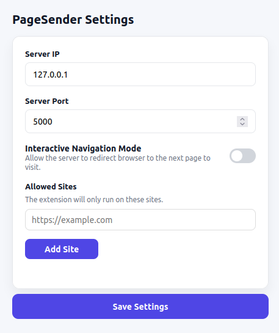

# Collaborative Scraper (browser extension)

This repository contains the browser extension of the [Collaborative Scraper](https://github.com/Angelo942/collaborative_scraper_server) project. The extension is responsible for collecting the visited pages and sending them to the parsing server.

---

## Overview

The Collaborative Scraper browser extension runs locally in the user’s browser and acts as a lightweight client:

- It observes pages visited by the user
- Submits approved pages to the backend server
- Optionally reacts to server instructions to guide further navigation

All parsing, storage, and scraping logic is handled by the server.

---

## Usage



### Website Permissions

By default, the extension does **not** send any pages.

Each website must be **explicitly approved by the user** before the extension is allowed to run on it.  
Allowed websites are managed through the extension’s **options menu**.

This design ensures that page collection is always user-controlled.

---

### Server Configuration

Before using the extension, If you are not hosting the parsing server locally with default parameters, configure the correct address by setting:

- **Server IP**
- **Server Port**

---

### Sending Pages

- Clicking the **extension icon** on a tab does two things:
  1. It **activates** that tab for sharing, and
  2. It submits the currently open page to the server.
- Until you click the icon, **no pages are sent** — even on an allowed site. A freshly opened tab is not active yet, so simply browsing an allowed site will not send anything.
- Once a tab has been activated, it stays active for the life of the tab: pages you navigate to afterwards are submitted automatically. Activation is reset when the tab is closed (or the browser is restarted), so you need to click the icon again on a new tab.

---

### Interactive Mode

The options menu allows enabling an **interactive mode**.

When interactive mode is active:

1. A page is sent to the server
2. The server responds with instructions on which page to visit next
3. If the target website has been allowed by the user, the current browser tab is redirected to requested page and the process repeats

The process continues as long as the tab remains open.

#### The `CLICK` instruction

`{ "type": "CLICK", "xpath": "...", "wait_for": "..." }` clicks the first element at `xpath`, waits until the element at `wait_for` has changed (or anything on the page, when it is empty), then sends the page to `/receive` as usual, with the token of the preceding `set_token`. The payload's `meta.click` is `{ xpath, ok, error }`: the page is sent even when the element is missing or nothing changed within 10 s, so the server can move on.

## Installation

At the moment, the extension is only available for **Firefox** and must be installed manually.

### 1. Clone the repository

```bash
git clone https://github.com/Angelo942/collaborative_scraper_extension.git
```

### 2. Load the extension in Firefox

- Open Firefox and navigate to `about:debugging#/runtime/this-firefox`
- Click Load Temporary Add-on…
- In the file selection dialog, navigate to `collaborative_scraper_extension/firefox_extension/`
- Select manifest.json

The extension will be loaded as a temporary add-on and will remain active until Firefox is restarted.
